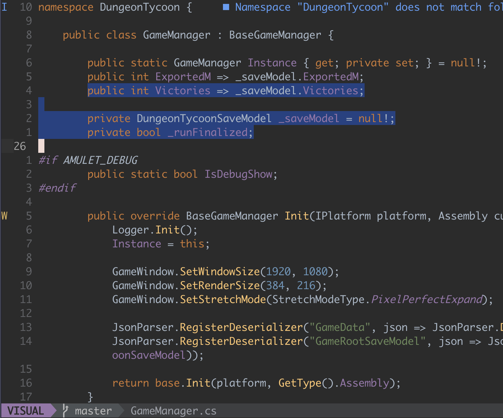

# darcula.nvim

A Neovim port of the **Islands Darcula** theme from JetBrains IDEs (the default dark look since 2025.3).

The colorscheme is named `darcula`.



## Features

- Classic Darcula syntax colors on the Islands UI palette
- Treesitter and LSP (diagnostics, references, inlay hints) support
- Terminal (`:terminal`) ANSI colors
- Per-plugin highlight groups, each of which can be disabled
- [lualine](https://github.com/nvim-lualine/lualine.nvim) theme

### Supported plugins

- [gitsigns.nvim](https://github.com/lewis6991/gitsigns.nvim)
- [telescope.nvim](https://github.com/nvim-telescope/telescope.nvim)
- [nvim-cmp](https://github.com/hrsh7th/nvim-cmp)
- [blink.cmp](https://github.com/Saghen/blink.cmp)
- [neo-tree.nvim](https://github.com/nvim-neo-tree/neo-tree.nvim)
- [nvim-tree.lua](https://github.com/nvim-tree/nvim-tree.lua)
- [indent-blankline.nvim](https://github.com/lukas-reineke/indent-blankline.nvim)
- [lualine.nvim](https://github.com/nvim-lualine/lualine.nvim)

## Requirements

- Neovim (tested on 0.12.6)
- A terminal with true color support (Neovim 0.10+ enables `termguicolors` automatically when it detects it; the colorscheme does not change this option)

## Installation

### [lazy.nvim](https://github.com/folke/lazy.nvim)

```lua
{
  "rootools/darcula.nvim",
  lazy = false,
  priority = 1000,
  opts = {},
  config = function(_, opts)
    require("darcula").setup(opts)
    vim.cmd.colorscheme("darcula")
  end,
}
```

### `vim.pack` (Neovim 0.12+)

```lua
vim.pack.add({ "https://github.com/rootools/darcula.nvim" })
vim.cmd.colorscheme("darcula")
```

### Other plugin managers

Install `rootools/darcula.nvim` the usual way, then:

```vim
colorscheme darcula
```

## Configuration

Calling `setup()` is optional. If you use it, call it **before** `:colorscheme`.

Comments and inline diagnostic messages (LSP virtual text and virtual lines) are italic by default. Override `styles.comments` / `styles.diagnostics` to change this; they accept any highlight attributes (`italic`, `bold`, `underline`, ...):

```lua
require("darcula").setup({
  styles = {
    comments = { italic = false },
    diagnostics = { italic = false },
  },
})
```

All plugin integrations are enabled by default. Set a plugin to `false` to skip its highlight groups:

```lua
require("darcula").setup({
  styles = {
    comments = { italic = true },
    diagnostics = { italic = true },
  },
  plugins = {
    gitsigns = true,
    telescope = true,
    cmp = true,
    blink = true,
    ["neo-tree"] = true,
    ["nvim-tree"] = true,
    ["indent-blankline"] = true,
  },
})

vim.cmd.colorscheme("darcula")
```

The keys match the file names in `lua/darcula/groups/plugins/`. An unknown key is ignored silently.

### lualine

```lua
require("lualine").setup({
  options = { theme = "darcula" },
})
```

## Palette

| Role | Color |
| --- | --- |
| Editor background | `#2B2B2B` |
| Window frame, status line | `#3C3F41` |
| Text | `#A9B7C6` |
| Keywords | `#CC7832` |
| Strings | `#6A8759` |
| Numbers | `#6897BB` |
| Comments | `#808080` |
| Function declarations | `#FFC66D` |
| Fields and constants | `#9876AA` |
| Annotations | `#BBB529` |
| Selection | `#214283` |

The full palette, with the JetBrains source of every color, is in [`lua/darcula/palette.lua`](lua/darcula/palette.lua).

## Project layout

```
colors/darcula.lua                 entry point for :colorscheme
lua/darcula/init.lua               setup() and load()
lua/darcula/palette.lua            palette
lua/darcula/groups/init.lua        merges the group modules
lua/darcula/groups/base.lua        core UI: menus, status line, tabs, spelling, diff
lua/darcula/groups/syntax.lua      classic Vim syntax groups
lua/darcula/groups/treesitter.lua  Treesitter captures
lua/darcula/groups/lsp.lua         diagnostics and LSP
lua/darcula/groups/plugins/        one file per plugin
lua/lualine/themes/darcula.lua     lualine theme
```

## Contributing

To add support for another plugin, create `lua/darcula/groups/plugins/<name>.lua`. It must return a function that takes the palette and returns a table of highlight groups. Then add `<name>` to the `plugins` list in `lua/darcula/groups/init.lua`.

To try changes from a clone of the repository:

```sh
nvim --cmd "set rtp^=." -c "colorscheme darcula"
```

Inspect the highlight groups under the cursor with `:Inspect`.

## License

[MIT](LICENSE)

## Credits

The colors come from the [JetBrains/intellij-community](https://github.com/JetBrains/intellij-community) sources (Apache-2.0, © JetBrains s.r.o.):

- UI: `platform/platform-resources/src/themes/islands/ManyIslandsDarcula.theme.json`
- Editor: the `Darcula` scheme in `platform/platform-resources/src/DefaultColorSchemesManager.xml`

Islands Darcula is a UI theme with `editorScheme: "Darcula"`: syntax colors come from classic Darcula, and the "islands" look comes from the UI colors.

This project is not affiliated with or endorsed by JetBrains.
